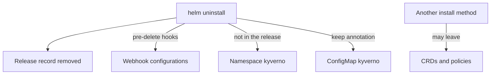

# Uninstalling Kyverno and Cleaning Up

Astronaut, taking a station apart is not the same as pressing one button. Helm removes what it built. But some pieces are made by Kyverno while it runs, and some pieces sit outside the release. This part shows the removal command, then teaches the checks that tell you what is still in orbit, and how to clear it in a safe order.

Your playground runs Kyverno with Helm and holds one `ClusterPolicy`, `require-owner-label`. A `ClusterPolicy` is a rule book for the whole solar system. You will see what removal does to it.

## Look before you remove

Before you take anything apart, write down what exists. Three things matter: the policies, the webhook configurations and the custom resource definitions. A webhook configuration is the registry desk's call line to the inspectors: it tells the API server which requests to send to Kyverno. A custom resource definition (CRD) is a new kind of form that the registry learns to accept.

Policies are custom resources, so they live and die with their definitions. Save a copy first if you want to keep them:

<!-- astrona:playground:renew -->

```sh
kubectl get clusterpolicy -o yaml > policies-backup.yaml
kubectl get validatingwebhookconfigurations,mutatingwebhookconfigurations
kubectl get crd -o name | grep -c 'kyverno.io$'
```

The webhook list shows configurations whose names start with `kyverno`. The last command counts the custom resource definitions whose names end in `kyverno.io`.

## Uninstalling with Helm

The command is short. It takes the release name and the namespace:

```sh
helm uninstall kyverno -n kyverno
```

Helm deletes every object that the release created and then deletes the release record itself, so `helm list -n kyverno` no longer shows it.

### What the chart does for you

This chart adds work before the deletion. You do not need to trust a description of it. Render the chart and look for the objects marked as pre-delete hooks, which Helm runs before it removes anything:

```sh
helm template kyverno kyverno/kyverno -n kyverno | grep -E 'name: kyverno-(scale-to-zero|rm-webhooks)$|helm.sh/hook: pre-delete|- (scale-deploy|delete-webhooks)'
```

You will find two Jobs marked `pre-delete`, named `kyverno-scale-to-zero` and `kyverno-rm-webhooks`. The first runs the command `scale-deploy` and the second runs `delete-webhooks`, so the chart removes the webhook configurations on purpose. A value called `webhooksCleanup.enabled` switches these hooks on or off, and it is on by default. Look it up with `helm show values kyverno/kyverno` before you rely on it.

### What the chart leaves

The same render also shows two facts about what stays. The ConfigMap named `kyverno` carries the annotation `helm.sh/resource-policy: "keep"`, so Helm leaves it in place. And no `Namespace` object appears in the render, because the namespace came from `--create-namespace` and is not part of the release. Helm does not delete a namespace it did not render.

## What can remain, and how to check

Whatever your install method, the facts that decide the leftovers are small. The release record is gone after `helm uninstall`. The namespace usually stays. Webhook configurations stay when the cleanup hooks were switched off or failed, or when Kyverno came from the manifest. Custom resource definitions stay when something other than the release put them there.



The diagram shows what each part of the removal touches. Do not read it as a promise. Run the checks to see which objects are really there.

Run these checks after every removal:

```sh
helm list -A --all
kubectl get validatingwebhookconfigurations,mutatingwebhookconfigurations
kubectl get crd -o name | grep -E 'kyverno.io$|wgpolicyk8s.io$'
kubectl get namespace kyverno
kubectl get all,configmap -n kyverno
```

Read the output like this:

- `helm list -A --all` should not show a release named `kyverno`. The `--all` flag also lists releases that are stuck in a failed or deleting state.
- Any webhook configuration with `kyverno` in its name is a leftover.
- Any custom resource definition that ends in `kyverno.io` is a leftover. The ones ending in `wgpolicyk8s.io` are the policy report kinds that this chart also installs. They are not under the Kyverno name, so decide on them on purpose: another tool may use them.
- A `kyverno` namespace that still exists, and whatever sits in it, is a leftover.

## Cleaning up in a safe order

Delete the call line first, then the forms, then the planet. The order matters. If the webhook configurations stay while their target is gone, the API server still tries to call a service that no longer answers. Depending on how each webhook is set to fail, ordinary requests can then be refused or slowed.

### Webhook configurations

List the validating and mutating configurations with `kyverno` in the name, and delete each one:

```sh
for name in $(kubectl get validatingwebhookconfigurations -o name | grep kyverno); do kubectl delete "$name"; done
for name in $(kubectl get mutatingwebhookconfigurations -o name | grep kyverno); do kubectl delete "$name"; done
```

If the cleanup hooks already removed them, the lists are empty and the loops do nothing.

### Custom resource definitions

Deleting a custom resource definition also deletes every custom resource of that kind, such as every `ClusterPolicy`. That is why you saved a backup. Remove each one that ends in `kyverno.io`:

```sh
for crd in $(kubectl get crd -o name | grep 'kyverno.io$'); do kubectl delete "$crd"; done
```

### The namespace

Last, remove the planet itself. This also removes anything still inside it, such as the kept ConfigMap:

```sh
kubectl delete namespace kyverno
```

Run the five checks from the section above again. A namespace can show `Terminating` for a short time while its contents go away. Check again after a minute.

## Removing a manifest install

If Kyverno came from `install.yaml`, run `kubectl delete -f` with the same file and the same version. It deletes every object that the file lists, including the namespace and the custom resource definitions. But the file holds no webhook configuration, and there are no cleanup jobs, so the webhook configurations that Kyverno made while running are still there. Run the checks, and clean them up with the loops above.

## Common pitfalls

> [!WARNING]
> - **Trusting `helm uninstall` as the whole job.** The release record is gone, but the namespace and, depending on the install, webhooks or definitions can remain. Run the checks.
> - **Deleting the namespace before the webhook configurations.** Requests keep going to a service that no longer answers.
> - **Deleting custom resource definitions without a backup.** Every policy of that kind goes with them.
> - **Matching names loosely.** Use `kyverno` for webhook names and `kyverno.io$` for definitions, and read the list before you delete. Other tools have objects with similar names.
> - **A namespace or definition stuck in `Terminating`.** Something inside still holds it. Read its `status` with `kubectl get ... -o yaml` and list what is left in it.

## Your mission: Remove Kyverno Cleanly

You can now remove a Helm release and check the cluster for the leftovers: webhook configurations, custom resource definitions and the namespace. The mission asks you to remove Kyverno from a cluster where it runs with a policy, so that nothing of Kyverno is left and ordinary Pods can be created again.

Pause the playground first, so the mission has the memory it needs:

```sh
astrona stop ats-008-playground-010-02
```

Start the mission:

```sh
astrona run --git ssh://git@github.com/astrona-io/ATS008.git -c sections/section-010/module-02/labs/lab-01
```

Read the task in [`question.md`](./labs/lab-01/question.md) and solve it on your own first. When you think you are done, send it for grading:

```sh
astrona submit -c sections/section-010/module-02/labs/lab-01
```

When the mission is done, remove it and start the playground again:

```sh
astrona destroy ats-008-lab-013
astrona start ats-008-playground-010-02
```
