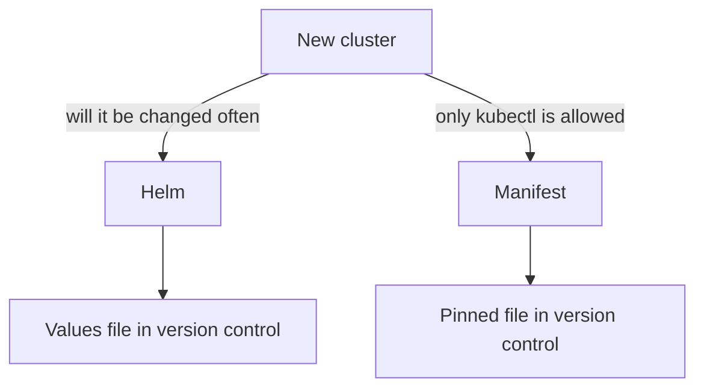

# Choosing Helm or the Manifest

Astronaut, you have now built the station both ways, and taken it apart. This last part puts the two methods side by side, gives you a short way to choose, and shows how to tell which method an existing cluster used. That last skill matters most on the day you inherit a cluster that nobody documented.

## The two methods side by side

Both methods end with the same four controllers. What differs is everything around them.

| Question | Helm | Manifest (`install.yaml`) |
| --- | --- | --- |
| Is there a release record? | Yes, with a flight record of revisions | No |
| Where do your settings live? | In a values file, read back with `helm get values -a` | In the file you edit, or in live patches |
| Can you roll back? | Yes, with `helm rollback` to an earlier revision | Apply the earlier file again |
| Does removal clean up after itself? | The chart runs cleanup hooks, then deletes the release | No hooks. You delete the file's objects and check for leftovers |
| What does it need? | The `helm` command and the chart repository | Only `kubectl` and the release file |

The table is about how each method behaves. It does not say that one is "safe" and the other is not.

## Choosing

Pick Helm when the cluster is one you will keep and change. You get named settings, a record of every change and a cleanup routine. Kyverno's documentation recommends Helm for this reason.

Pick the manifest when you must install with `kubectl` alone, for example on a locked-down cluster, in a small test or in a pipeline that already applies plain files. Pin the version in the address, and keep the file in version control so that the file is your record.



The diagram shows the choice and what you keep under version control in each case: a values file for Helm, a pinned file for the manifest.

## Telling which method a cluster used

On a cluster you did not build, ask the cluster. Two checks answer it. The first lists the Helm releases in the namespace. The second reads the label that Helm adds to the objects it creates:

<!-- astrona:playground:renew -->

```sh
helm list -n kyverno
kubectl get deploy -n kyverno -o jsonpath='{range .items[*]}{.metadata.name}{"\t"}{.metadata.labels.app\.kubernetes\.io/managed-by}{"\n"}{end}'
```

### See it in your playground

Run both commands in your playground. The release `kyverno` is listed, and each Deployment shows `Helm` in the second column. On a manifest install, the first command lists nothing and the second column is empty, because the file has no such label.

This matters before you change anything. `helm upgrade` only works on a release that Helm knows. A manifest install is changed by applying a newer file. And the checks for leftovers after a removal are the same for both, but the manifest has no hooks to help.

### Do not mix the methods

Do not install the file over a Helm release, or the chart over a manifest install. The objects are already there, and the two tools keep their own records of who owns what. If you must switch, remove the old install completely, run the leftover checks, and install again with one method.

## Common pitfalls

> [!WARNING]
> - **Choosing by habit.** Choose by what you need afterwards: settings, rollback and cleanup, or only `kubectl`.
> - **Running `helm upgrade` on a manifest install.** Helm has no release to upgrade. Apply the newer file instead.
> - **Switching methods in place.** Both tools think they own the objects. Remove the old install and check for leftovers first.
