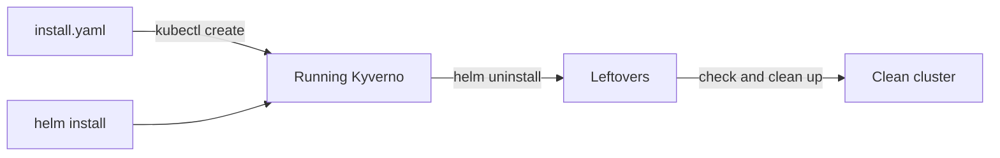

# Installing from Manifests and Removing Kyverno Cleanly

Astronaut, Helm is not the only way to put Kyverno on a cluster. Every Kyverno release also ships one big file, `install.yaml`, that lists every object Kyverno needs. This is the parts list for building the station by hand: no shipyard crane, and no flight record. The same module also covers the other end of the story: taking the station apart again without leaving debris in orbit.

Removing software looks easy, and that is the trap. Kyverno watches writes across the whole solar system through webhooks, and it adds new kinds of forms through custom resource definitions. If a few pieces stay behind, the registry desk can keep calling a station that no longer exists.

The diagram shows two ways in, and one way out that is not finished until you check for leftovers and remove them.

## Learning objectives

After this module you can:

- Install Kyverno from the release `install.yaml`, pinned to one version, and explain why `kubectl create` is the usual choice and plain `kubectl apply` can fail.
- Name what a manifest install does not give you: no Helm release, no values and no `helm history`.
- Uninstall a Helm release and list what it leaves behind: the namespace, webhook configurations, custom resource definitions and their custom resources.
- Check for leftovers with `kubectl` and remove them in a safe order.
- Choose between Helm and the manifest for a given cluster, and tell which one was used on an existing cluster.

## Before you start

Every mission starts with a pre-flight check, astronaut. Here is what this module expects you to know, and where you will practise.

### What you should already know

- **Basic `kubectl`.** Getting, creating and deleting objects, and reading output.
- **A first Helm install of Kyverno.** You know what a release is: one assembled station with its own name and flight record. You know `helm install` and `helm list`.

### Where you practise

You practise in a playground: a `kind` cluster (a training solar system in the simulator) with `kubectl` and `helm` ready to use. Kyverno is already installed there with Helm, in the `kyverno` namespace, together with one `ClusterPolicy` named `require-owner-label`, so that you can see what removal changes. Nothing in the playground is graded.

The graded mission at the end of the second part uses a separate, fresh cluster.

## How this module is organised

1. **[Installing from the Release Manifest](./course-01-installing-from-the-release-manifest.md):** pinning a version, `kubectl create` against `kubectl apply`, and what a manifest install does not give you.
2. **[Uninstalling Kyverno and Cleaning Up](./course-02-uninstalling-and-cleaning-up.md):** `helm uninstall`, what can remain, how to check, and how to clean up in a safe order. Your mission follows this part.
3. **[Choosing Helm or the Manifest](./course-03-choosing-helm-or-the-manifest.md):** when each method fits, and how to tell which one an existing cluster uses.
4. **[Summary](./course-04-summary.md):** what you learned, your mission, and cleaning up.

## Why this matters

A cluster that once ran Kyverno should not carry its debris. Leftover webhooks can slow or block ordinary writes, and leftover custom resource definitions can confuse the next install. If you know where the pieces live and how to check for them, removal is a short, safe routine.

Launch your playground now, and keep it running next to you while you read the parts:

<!-- astrona:playground -->
