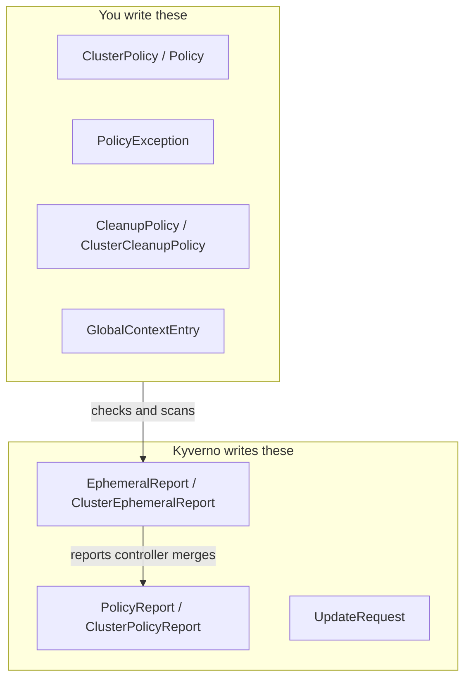

# Kyverno's CRD Surface

Kyverno does not add one opaque program to your cluster. It teaches mission control's registry desk a set of new kinds of form, called custom resource definitions (CRDs), and then runs crews that watch those forms. Some forms you fill in yourself. Others Kyverno fills in for you and expects you only to read.

Mixing the two up is a common reason for the question "why is my policy not doing anything?". This module draws the star chart: which forms exist, which ones you write, which ones Kyverno writes, and how to see them on a live cluster. It ends with one hands-on mission: a signed waiver for one ship.

The diagram shows the two families. Everything on the left is input from you. Everything on the right is output from Kyverno's crews.

## How this module is organised

- **The Kyverno CRD map** shows how to list every form Kyverno registered, read its versions and read its fields with `kubectl`.
- **Policy exceptions** covers the `PolicyException` waiver, why it is switched off by default, and the two admission controller flags that turn it on. This part ends with the mission `PolicyException CRD Lab`.
- **Cleanup policies and global context entries** looks at the other forms you write: salvage schedules and shared star charts.
- **Generated CRDs: reports and queues** looks at the forms Kyverno writes: report cards, scratch notes and the construction crew's work orders.
- **Summary** recaps all four parts and lists the mission.

## Learning objectives

After this module you can:

- List the CRDs Kyverno registers and sort each one into "you write it" or "Kyverno writes it".
- Read the versions and the fields of a Kyverno CRD on a running cluster.
- Explain what a `PolicyException` does, why it is off by default, and which two admission controller flags switch it on and limit where it can be written.
- Write a `PolicyException` that exempts one Pod from one rule and prove that other Pods are still checked.
- Describe the shape of a `ClusterCleanupPolicy` and what a `GlobalContextEntry` caches.
- Tell a `PolicyReport` from the intermediate reports and the `UpdateRequest` queue.

## Before you start

You should know what a `ClusterPolicy` is: a rule book with `match` and `validate` parts. You also need `kubectl` and a terminal. You do not need any other knowledge of Kyverno internals.

## Where you practise

Your playground is a training solar system on your laptop: a `kind` cluster with **Kyverno v1.13.2**, installed from the release `install.yaml` file (the "parts list" method, with no Helm release). The version is pinned on purpose, so the forms, the API versions and the flags in this module match what you see.

The playground has a planet (namespace) called `checkout` and one rule book, the `ClusterPolicy` named `require-owner-label`. It is set to `Enforce`, so any Pod without a non-empty `owner` label is turned away at the gate. Nothing else is set up. Launch it now and keep it open next to the reading:

<!-- astrona:playground -->
