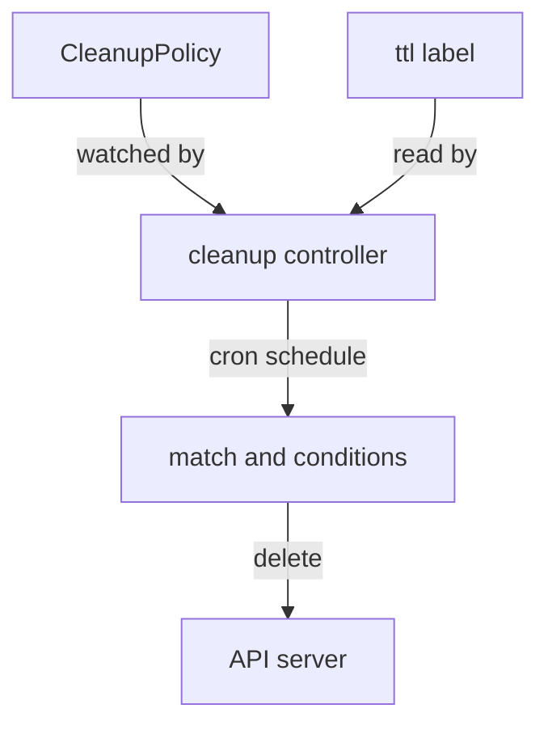

# Cleaning Up Resources with CleanupPolicy and ClusterCleanupPolicy

Ships that are left in orbit forever turn into space junk. In a cluster, the junk is old test objects, finished jobs and leftover copies of data. Kyverno has a salvage crew for this: the cleanup controller. You hand it a salvage schedule, written as a `CleanupPolicy` or a `ClusterCleanupPolicy`, and it removes the matching objects for you.

This module shows how to write a schedule, how to give the salvage crew the clearance it needs, and how to prove that it ran.

The diagram shows the crew at work. It reads your policy, wakes up on the schedule, finds the matching objects and asks the API server to delete them. It also reads a time-to-live label on single objects.

## How this module is organised

- **Cleanup policies: the salvage schedule** covers the API version, `schedule`, `match`, `exclude` and `conditions`.
- **The time-to-live label** shows how a single object can carry its own expiry date, with no policy at all.
- **Clearance for the salvage crew and checking that it ran** shows which permissions the cleanup controller needs and how to tell that it did its job. This part ends with the mission `Cleanup Policy Lab`.
- **Summary** recaps the parts.

## Learning objectives

After this module you can:

- Write a `CleanupPolicy` and a `ClusterCleanupPolicy` with `schedule`, `match`, `exclude` and `conditions`, using the `kyverno.io/v2` API version.
- Explain the difference between a namespaced and a cluster-wide cleanup policy.
- Use the label `cleanup.kyverno.io/ttl` to expire a single object.
- Explain why the cleanup controller needs its own delete permission and grant it with an aggregated `ClusterRole`.
- Check that a cleanup ran, with `kubectl auth can-i`, the policy status and the controller logs.

## Before you start

You need `kubectl`, namespaces, labels and the idea of a cron schedule: five fields (minute, hour, day of month, month, day of week) that say when something runs. For example `* * * * *` means every minute. You do not need any other knowledge of Kyverno.

## Where you practise

Your playground is a training solar system with the **current Kyverno Helm chart** (chart 3.9.x, Kyverno v1.19.x), installed with Helm as release `kyverno` in the namespace `kyverno`. This is a different version from the playground of the CRD surface module, which runs Kyverno v1.13.2. Here everything matches the current chart.

The planet `docking-bay` holds two ConfigMaps: `old-scrap` with the label `scrap: "true"` and `keep-me` with no label. There is no cleanup policy yet. Launch the playground now and keep it open while you read:

<!-- astrona:playground -->
