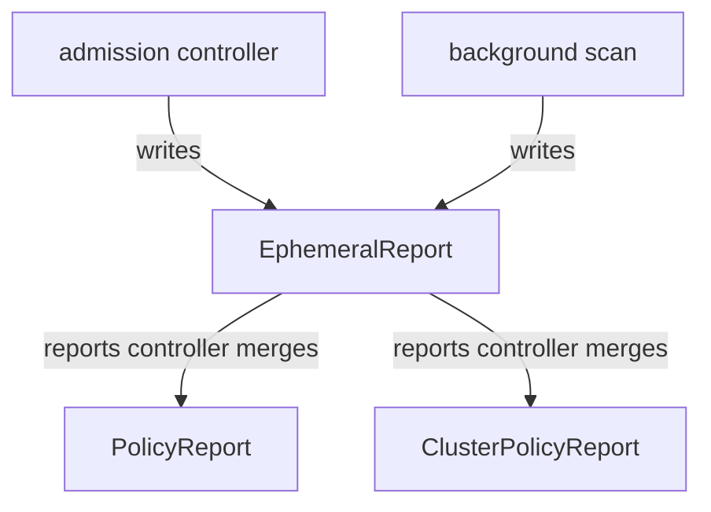

# Reading Policy Reports and Intermediate Reports

A rule book is only half of an inspection. The other half is the report card that tells you which ships broke the rules. Kyverno writes that report card for you, as Kubernetes objects. This module teaches you to find the report cards, read them with `kubectl`, and understand the scratch notes and the background scan behind them.

The diagram shows the path of one result. Inspectors write scratch notes. The records office merges them into the report cards that you read.

## How this module is organised

- **Audit and Enforce, and the report kinds** shows why a result is recorded, and where `PolicyReport` and `ClusterPolicyReport` live.
- **Reading results with kubectl** reads summary counts and single results with columns and JSONPath. This part ends with the mission `Policy Reports Lab`.
- **Background scans and intermediate reports** explains the scratch notes, the background scan and the reports controller flags.
- **Summary** recaps the parts.

## Learning objectives

After this module you can:

- Explain the difference between `Audit` and `Enforce` and what each one leaves in a report.
- Tell a `PolicyReport` from a `ClusterPolicyReport` and say which resources land in each.
- Read the `summary` counts and the `results` of a report with `kubectl` and JSONPath.
- Explain what ephemeral (intermediate) reports are and which controller merges them.
- Explain what a background scan is and where its interval is set.

## Before you start

You need `kubectl`, namespaces, Deployments and labels, and the idea of a `ClusterPolicy`: a rule book whose rules match objects and check them.

## Where you practise

Your playground is a training solar system with the **current Kyverno Helm chart** (chart 3.9.x, Kyverno v1.19.x), installed with Helm as release `kyverno`.

The planet `hangar` has four Deployments: `falcon`, `comet`, `nova` and `pulsar`. The `ClusterPolicy` `require-crew-labels` runs in `Audit` mode and wants the labels `owner` and `team` on every Deployment in `hangar`. A second `ClusterPolicy`, `require-planet-env`, runs in `Audit` mode and wants the label `env` on the planets `hangar` and `depot`. Some of these break the rules on purpose. Launch the playground now and keep it open:

<!-- astrona:playground -->
