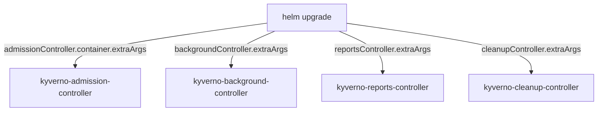

# Tuning Kyverno's Controllers with Flags

Install Kyverno with Helm and `kubectl get pods -n kyverno` shows four crews, not one. Each crew is its own Deployment: an admission controller, a background controller, a reports controller and a cleanup controller. Each one runs its own program, and each program has its own dials, which Kyverno calls flags. A flag is a setting written on the command line when the program starts, such as `--genWorkers=5`.

This module teaches you to treat Kyverno as four separate programs. You read the live flags straight off the cluster, and you change them the supported way: through the Helm release, never by hand.

The diagram shows one Helm command feeding four different value paths, and the admission controller path is the only one with `container` in it.

## What you will learn

The module has two parts:

1. **The Four Controllers and Their Flags** names the job of each crew, shows the flags the chart already sets, and teaches you to read a crew's live flags from its Deployment.
2. **Setting Flags with Helm** shows how `extraArgs` works, why the admission controller's path is different, and how to prove a flag arrived. It ends with the mission for this module.

## Learning objectives

After this module you can:

- Name the four Kyverno controllers and match each to its job (admission, background work, reports, cleanup).
- List at least one tunable flag for each controller and say what it controls.
- Read a controller's live flags from its Deployment with `kubectl`.
- Set a controller flag with Helm's `extraArgs` map, using the right path for each controller.
- Say why a flag change restarts the crew's Pods, and why a change to the Kyverno ConfigMap does not.

## Before you start

You should know how to run `helm install` and `helm upgrade`, and what a Deployment is: a squadron order that keeps a set number of identical ships (Pods) flying. A Helm release is one assembled station with its own flight record, and `--set` writes a single change on the order form.

The `extraArgs` value is a map in the current chart (version 3.9.x, Kyverno v1.19.x). You write it as `key: value` pairs, and the chart turns each pair into `--key=value`. A list like `extraArgs[0]=--genWorkers=5` does not work: the chart renders it as `--0=--genWorkers=5`.

## Where you practise

Your playground is a training solar system: a kind cluster on your laptop with Kyverno already installed from the Helm chart at its default values. The release is named `kyverno` and sits in the `kyverno` namespace, with all four controllers running. There is nothing else in the cluster to set up.

Launch your playground now, and keep it running next to you while you read the parts:

<!-- astrona:playground -->
