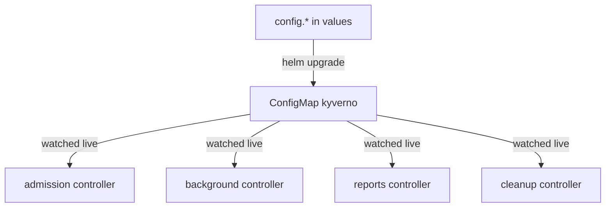

# The Kyverno ConfigMap

Flags are read once, when a program starts. Kyverno also has a second set of dials that its crews read all the time: a ConfigMap named `kyverno` in the `kyverno` namespace. A ConfigMap is a small object that holds named settings. Think of it as the station notice board: when someone pins a new note, every crew sees it at once, and nobody has to restart.

This module shows you what is pinned on that board, where each note comes from in the Helm chart, and how to change a note safely. You will also see why a mistake on the board can matter more than a wrong flag, because it decides which requests Kyverno looks at.

The diagram shows one ConfigMap, built from the chart's `config` values, that all four crews watch without restarting.

## What you will learn

The module has two parts:

1. **Reading the Kyverno ConfigMap** shows how the chart builds the ConfigMap, what each key means, and how to read it from the cluster and from `helm template`.
2. **Changing the ConfigMap with Helm** shows how to exclude people and kinds from checking, how to add to the resource filters without losing the defaults, and how to turn on success events. It ends with the mission for this module.

## Learning objectives

After this module you can:

- Say which `config.*` chart values become keys of the `kyverno` ConfigMap.
- Read the live ConfigMap and the rendered ConfigMap (`helm template`) and tell whether they match.
- Explain what `excludeGroups`, `excludeUsernames`, `resourceFilters`, `generateSuccessEvents` and `defaultRegistry` do.
- Add a user to `excludeUsernames` and a namespace to the resource filters without losing the default entries.
- Show that a ConfigMap change took effect without any controller restarting.

## Before you start

You need to know how to run `helm upgrade --reuse-values` and `helm template`. A Helm release is one assembled station with its own flight record, and `--reuse-values` keeps the settings you made earlier.

Helm replaces a whole list when you set it again. If you set `config.excludeGroups` with one group, the old groups are gone. The module shows a safer way for the resource filters.

## Where you practise

Your playground is a training solar system: a kind cluster with Kyverno installed from the Helm chart at default values, release `kyverno` in namespace `kyverno`. A planet (namespace) named `mission-ops` already exists for the exercises. Nothing else is set up.

Launch your playground now, and keep it running next to you while you read the parts:

<!-- astrona:playground -->
