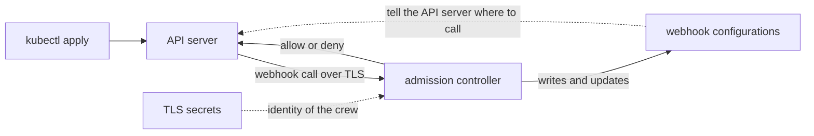

# Webhooks, Failure Policy and Certificates

Every launch request on the cluster passes the registry desk, which is the Kubernetes API server. The desk does not check the rule book itself. It rings a doorbell: a webhook, which is a call to a program that answers yes or no. Kyverno's admission controller is the crew that answers that bell.

This module shows how the doors are built, what happens when the crew does not answer, which launches use the doors at all, and how the crew proves who it is with a certificate. Each of these is set through Helm values, and you can see every result on the live cluster.

The diagram shows the API server calling the admission controller over TLS. The admission controller writes the webhook configurations that tell the API server where to call, and it holds the certificate that proves its identity.

## What you will learn

The module has three parts:

1. **Webhook configurations and failure policy** shows the doors Kyverno creates, what failure policy means, and how to let launches through when the crew is down.
2. **Choosing which launches use the webhooks** shows the namespace and object selectors, and the timeout for each call.
3. **Certificates for the webhooks** shows the two secrets, how they are renewed, the other ways to manage them, and how to replace a certificate. It ends with the mission for this module.

## Learning objectives

After this module you can:

- Find the Kyverno webhook configurations and read their failure policy, timeout and selectors.
- Explain what `Fail` and `Ignore` mean, and what `forceFailurePolicyIgnore` changes.
- Change `config.webhooks` without losing `kube-system`, and set the webhook timeout with a flag.
- Name the two TLS secrets of the admission controller and read a certificate with `openssl`.
- Tell apart the default certificates, `createSelfSignedCert` and `certManager`.

## Before you start

You need to know how to run `helm upgrade --reuse-values`, how a flag is set with `extraArgs`, and that the ConfigMap `kyverno` holds `config.*` settings. A request is one launch order sent to the cluster. A webhook configuration is a Kubernetes object that lists the doors.

## Where you practise

Your playground is a training solar system: a kind cluster with Kyverno installed from the Helm chart at default values, release `kyverno` in namespace `kyverno`. A planet (namespace) named `mission-ops` exists, and a policy named `audit-owner-label` is installed, so that Kyverno has something to register in its doors.

Launch your playground now, and keep it running next to you while you read the parts:

<!-- astrona:playground -->
