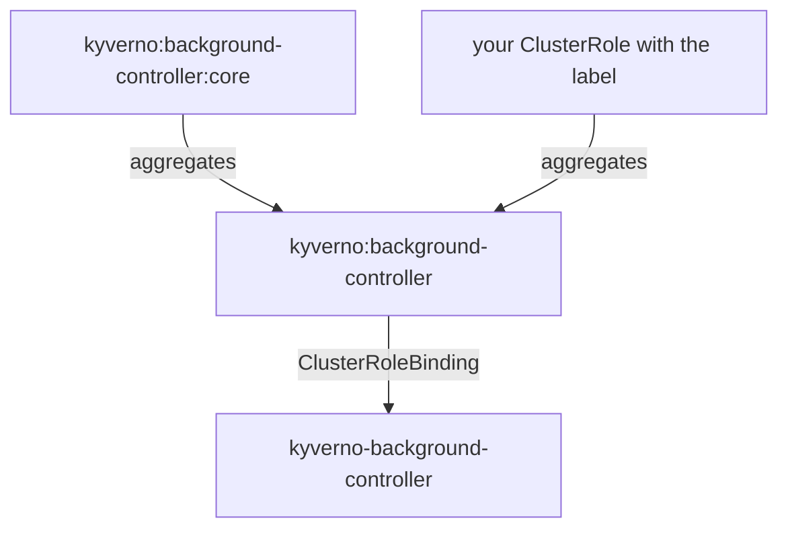

# ServiceAccounts, Aggregated ClusterRoles and the View Role

Every Kyverno crew flies under its own registration papers, and each set of papers points at one master clearance card. In this part you look at the four crews, open their master cards and see how a card collects smaller cards by their stamp. This matters because the stamp is the one safe way to give a crew more power.

## Four crews, four sets of papers

Kyverno runs four controllers. Each one has its own service account in the `kyverno` namespace, so a mistake in one crew's card does not hand its power to the other three.

| Controller | Service account | Does |
| --- | --- | --- |
| Admission | `kyverno-admission-controller` | Answers the registry desk's calls and checks each request |
| Background | `kyverno-background-controller` | Builds and repairs objects (`generate`, mutate existing) |
| Reports | `kyverno-reports-controller` | Patrols existing objects and files reports |
| Cleanup | `kyverno-cleanup-controller` | Removes old objects on a schedule |

The admission controller only needs to read what it checks. It has no business holding the write permissions that the background controller needs to build objects.

<!-- astrona:playground:renew -->

### See it in your playground

List the service accounts and the clearance cards that Kyverno's chart created:

```sh
kubectl get serviceaccount -n kyverno
kubectl get clusterrole -l app.kubernetes.io/part-of=kyverno
```

Look for four service accounts that start with `kyverno-` and end with `-controller`. In the ClusterRole list, look for one master card per controller named `kyverno:<controller>-controller` and one card named `kyverno:<controller>-controller:core` next to it.

## The master card and the stamp

Kubernetes can build one ClusterRole out of others. This is called **aggregation**. The master card has an `aggregationRule`: a label selector that says "include every card that carries this stamp". Kubernetes joins the rules of all matching cards into the master card by itself, live, with no program of yours.

Kyverno uses this for every controller. Each master card collects the cards that carry its stamp, which is a label:

| Label (value `"true"`) | Extends this controller |
| --- | --- |
| `rbac.kyverno.io/aggregate-to-admission-controller` | Admission |
| `rbac.kyverno.io/aggregate-to-background-controller` | Background |
| `rbac.kyverno.io/aggregate-to-reports-controller` | Reports |
| `rbac.kyverno.io/aggregate-to-cleanup-controller` | Cleanup |

The `:core` card, which Kyverno ships, is collected too. It carries three component labels that the master card also selects. The service account is bound to the master card with a `ClusterRoleBinding`.



The diagram shows two cards flowing into one master card, and the master card bound to the service account. Your own card needs only the right label to join.

### See the stamp in your playground

Read the master card of the background controller:

```sh
kubectl get clusterrole kyverno:background-controller -o yaml
```

Find the `aggregationRule` section. It lists the label `rbac.kyverno.io/aggregate-to-background-controller` and a second selector made of the component labels. The master card also has a `rules` list, which Kubernetes fills in from the cards it collects.

## The built-in view role

The admission, background and reports controllers are also bound to the built-in `view` ClusterRole. It is a visitor pass: they may look at most built-in objects and touch none. This is why a rule can read a `ResourceQuota` or a `NetworkPolicy` without a card of its own. The cleanup controller has no such binding.

The chart has values for this on each of the three controllers, for example `backgroundController.rbac.createViewRoleBinding` (default `true`) and `backgroundController.rbac.viewRoleName` (default `view`). They exist for clusters where the visitor pass has been renamed or removed.

### Ask the clearance office

Ask what the background controller may do with `ResourceQuota` objects. The first command asks about reading and the second about creating. If you do not have the `can_do` helper in your shell yet, define it from the playground guide first.

```sh
can_do list resourcequotas background
can_do create resourcequotas background
```

Look for `yes` on the first and `no` on the second. The visitor pass allows reading, and nothing else gives the permission to create.

## Common pitfalls

> [!WARNING]
> - **Thinking the controllers hold near-administrator power.** Read access comes from the `view` pass. Write access is narrow and comes from the cards that aggregate into each master card.
> - **Looking for the permissions in the master card's `rules` and finding nothing at install time.** Kubernetes fills the `rules` of an aggregated card in. Read the cards it collects, or ask `can-i`.
> - **Mixing up the four labels.** The label ends with the name of the controller that receives the permission. A card stamped for the reports controller does nothing for the background controller.
