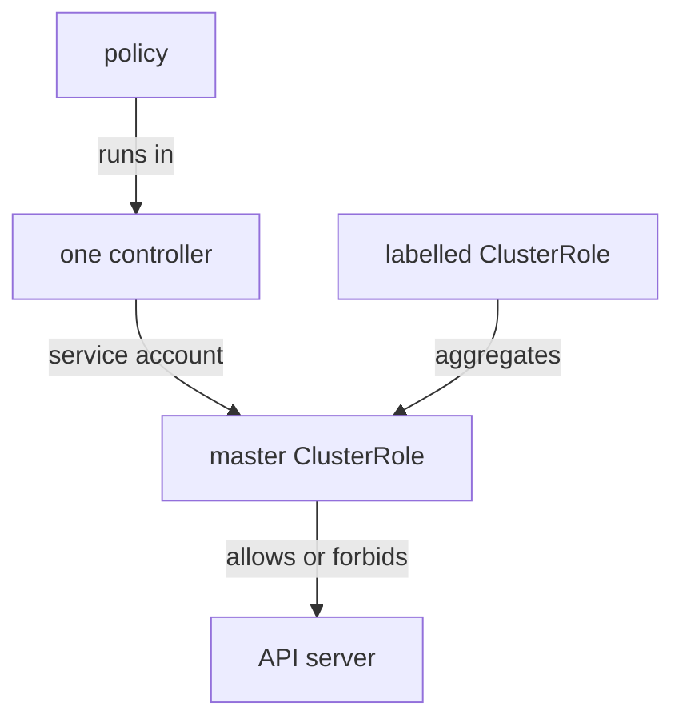

# When a Controller Lacks a Permission

A crew without the right card does not shout. The policy is accepted, and then nothing happens, or only part of it happens. In this part you learn the four ways it shows up, and then you fix the salvage crew with a stamped ClusterRole.

## Four failures, four crews

Each Kyverno feature runs in one crew, so a missing card hurts one feature.

| Job | Crew | Card needed | What you see without it |
| --- | --- | --- | --- |
| Remove objects with a cleanup policy | Cleanup | `delete` (and `list`) on the kind | The objects stay. Kyverno may also refuse the policy when you save it, with a message about the cleanup controller |
| Report on a custom resource | Reports | `get`, `list` and `watch` on the custom kind | No report results for that kind. The reports controller log shows "forbidden" errors. Admission checks of new objects still work |
| Mutate existing objects | Background | `update` on the target kind | The target is not changed. The failed work order waits in an `UpdateRequest` |
| Generate an object | Background | `create`, and `update` or `delete` when `synchronize` is on, on the generated kind | The object is not built. The failed work order waits in an `UpdateRequest` |

The admission crew reads what is in the request it is checking, so it rarely needs more. It needs a card when a rule looks up other objects, for example through an API call in a context.

The pattern is the same everywhere: find the job, find the crew, find the kind and the verb, then grant exactly that.



The diagram shows a policy running in one controller, and that controller's master card, with your labelled card joined in, deciding what the API server allows.

<!-- astrona:playground:renew -->

### See the salvage crew fail

The playground has ConfigMaps in `debris`. Ask the clearance office if the cleanup controller may delete them:

```sh
can_do delete configmaps cleanup
```

The answer is `no`. A cleanup policy for these ConfigMaps would get nowhere. Fix that first.

## Grant the permission with a label

Save this as `clusterrole-kyverno-cleanup-debris.yaml`:

```yaml
apiVersion: rbac.authorization.k8s.io/v1
kind: ClusterRole
metadata:
  name: kyverno-cleanup-debris
  labels:
    rbac.kyverno.io/aggregate-to-cleanup-controller: "true"
rules:
  - apiGroups: [""]
    resources: ["configmaps"]
    verbs: ["get", "list", "delete"]
```

The label is the cleanup crew's stamp. The rule names one kind and three verbs, and nothing more.

Apply it:

```sh
kubectl apply -f clusterrole-kyverno-cleanup-debris.yaml
```

Then check again:

```sh
can_do delete configmaps cleanup
```

The answer is now `yes`. Ask the same for `secrets` and look for `no`: the grant covers ConfigMaps only.

### Use the permission

Save this as `clustercleanuppolicy-purge-stale-logs.yaml`:

```yaml
apiVersion: kyverno.io/v2
kind: ClusterCleanupPolicy
metadata:
  name: purge-stale-logs
spec:
  schedule: "* * * * *"
  match:
    any:
      - resources:
          kinds:
            - ConfigMap
          namespaces:
            - debris
          selector:
            matchLabels:
              stale: "true"
```

The `schedule` field is a cron schedule: the five stars mean once every minute. The match picks ConfigMaps in `debris` with the label `stale: "true"`. Apply it:

```sh
kubectl apply -f clustercleanuppolicy-purge-stale-logs.yaml
```

Kyverno 1.19 may print a warning that this API version is deprecated. The policy still works. Wait a minute or two, then list the ConfigMaps:

```sh
kubectl get configmap -n debris
```

`old-log-1` and `old-log-2` are gone, and `keep-log` stays because its label is `stale: "false"`. The salvage crew did the work, with the card you gave it.

## Your mission: Cleanup Controller Permissions Lab

You can now tell which crew a failing feature belongs to and give that crew exactly one new card with an aggregation label. The mission asks you to let the cleanup controller delete ConfigMaps in a namespace called `scrap`, write a `ClusterCleanupPolicy`, and prove that the expired ConfigMaps go away while one stays, without giving the crew any wider power.

Pause the playground first, so the lab has the memory it needs:

```sh
astrona stop ats-008-playground-040-02
```

Start the lab, then grade it when you are done:

```sh
astrona run --git ssh://git@github.com/astrona-io/ATS008.git -c sections/section-040/module-02/labs/lab-01
astrona submit --git ssh://git@github.com/astrona-io/ATS008.git -c sections/section-040/module-02/labs/lab-01
```

When you are done, remove the lab and start the playground again:

```sh
astrona destroy ats-008-lab-018
astrona start ats-008-playground-040-02
```

## Common pitfalls

> [!WARNING]
> - **Stamping the card for the wrong crew.** The cleanup crew needs `aggregate-to-cleanup-controller`. A card stamped for the background controller does not help it.
> - **Granting more than the job needs.** `verbs: ["*"]` on `resources: ["*"]` works, and it also hands the crew the power to delete anything. Name the kind and the verbs.
> - **Forgetting `list`.** A cleanup crew has to find objects before it deletes them. The card needs `list` as well as `delete`.
> - **Expecting an instant cleanup.** A cleanup policy runs on its schedule. With `* * * * *`, wait up to a minute or two.
