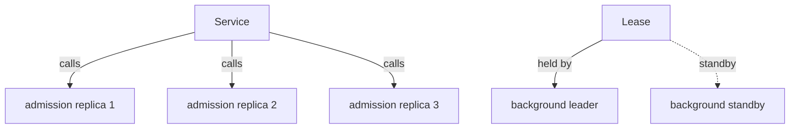

# Running Kyverno Highly Available

"Just set `replicas: 3`" is good advice for a simple web server. It is not enough for Kyverno. Kyverno is four crews bundled in one Helm release, and each crew has a different answer to the question "what happens when I run more than one copy of you?"

Get this wrong and you pay for it. If the inspectors at the launch gate (the admission controller) run as a single ship, one restart can stall every launch request in the solar system. If you add ships to a crew that only lets one ship work at a time, you spend fuel and gain nothing.

The picture shows the two models. Every admission replica answers calls at the same time. For the background crew, only the replica that holds the lease (the captain's baton) does the work.

## How this module is organised

1. **Why Replicas Behave Differently Per Controller** explains the admission controller's horizontal scaling and the leader election of the other crews.
2. **Installing for HA with Helm** installs Kyverno with a different replica count per controller, reads the leases, and explains what spreading ships over docks can and cannot do on a one-node training cluster.

## Learning objectives

After this module you can:

- Explain why the admission controller shares AdmissionReview traffic between all replicas, while the background and reports controllers use leader election for their work.
- State the minimum replica count for a highly available admission controller.
- Explain what extra replicas buy the background, reports and cleanup controllers.
- Run a `helm install` with the right replica count for each controller.
- Read leader-election state with `kubectl get lease -n kyverno`.
- Say what the default Pod anti-affinity does, and what a one-node cluster cannot show you.

## Before you start

You need to know how to install a chart with `helm install` and set a value with `--set`. You also need basic `kubectl`.

## Where you practise

Your playground is a single-node `kind` cluster, a training solar system with one space dock. The `kyverno` Helm repository is added. Kyverno is not installed, because installing it is your job. Launch the playground now and keep it next to you while you read the parts:

<!-- astrona:playground -->
