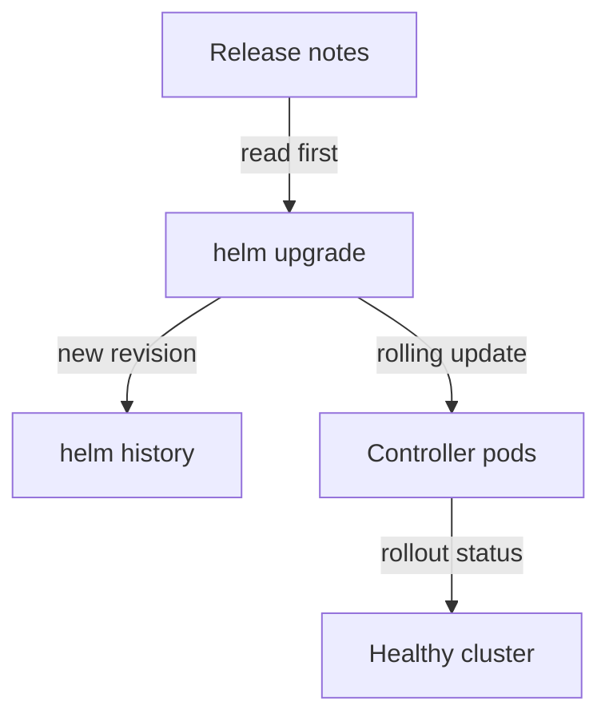

# Upgrading a Running Kyverno Installation

Kyverno is the inspection authority of your solar system. Every launch request passes through its admission controller, the inspectors at the launch gate. If an upgrade goes wrong while the inspectors are changing shifts, nothing new can be filed at the registry desk for a while. So you do not "just bump the version". You refit the station in orbit on purpose, with the right tool, a backup in hand and a clear idea of what "healthy" means afterwards.

Helm is the shipyard crane, and a Helm release is one assembled station with its own flight record. Each upgrade adds one entry, called a **revision**, to that flight record. This module shows how to add that entry safely.

The diagram shows the order of an upgrade: read the notes, run `helm upgrade`, then confirm both the flight record and the pods.

## How this module is organised

1. **The Helm Upgrade Path** covers the `helm upgrade` command, why `--reuse-values` matters, why you read the release notes for every version you skip, and what happens to Kyverno's custom resource definitions (CRDs) when you upgrade.
2. **Manifest Upgrades and Post-Upgrade Validation** covers why a station built by hand from a parts list has no in-place refit, what `kyverno migrate` does, and the backup and verification routine around every upgrade. It ends with the mission for this module.

## Learning objectives

After this module you can:

- Run `helm upgrade` against an existing Kyverno release to change values or move to a new chart version.
- Explain why a normal `helm upgrade` also updates Kyverno's CRDs, unlike charts that keep their CRDs in a special `crds/` folder.
- Explain why a release made with `kubectl create -f install.yaml` cannot be upgraded in place, and what to do instead.
- Back up `ClusterPolicy` and `Policy` objects before an upgrade.
- Prove an upgrade worked with `helm status`, `helm history` and rollout checks.
- Say what `kyverno migrate` is for.

## Before you start

You need `kubectl`, `helm` and a Kyverno release that was installed with Helm. You do not need anything else. The facts about Helm values that you need are explained where they are used.

## Where you practise

Your playground is a training solar system: a small `kind` cluster on your laptop with the `kyverno` Helm repository added and Kyverno installed with Helm at its default values. The release is called `kyverno`, it lives in the `kyverno` namespace and it is at revision 1. Nothing else is in the cluster, so every change you see comes from your own commands. Launch it now and keep it running next to you while you read:

<!-- astrona:playground -->
