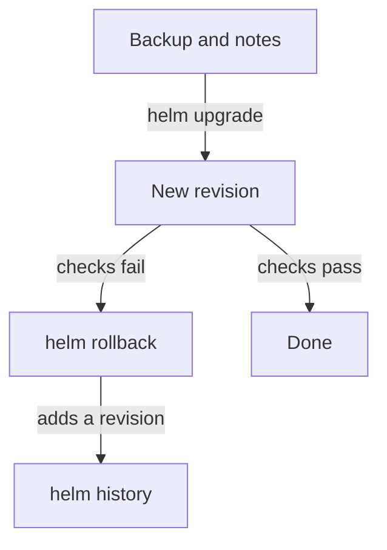

# Rolling Back and Recovering from a Bad Upgrade

Even a careful refit can go wrong. The new inspectors may not arrive at the launch gate, a setting may reset, or a new Kyverno version may behave in a way the bulletin warned about. Helm keeps a flight record of every revision of your station, and that record is how you return to a refit that worked.

This module is about the way back. You read the record, return to an earlier revision, learn what that return keeps and what it changes, and build the habits that make the next upgrade safer.

The diagram shows that a rollback is another step forward in the flight record: it adds a new revision, it does not erase the bad one.

## How this module is organised

1. **Reading the History and Rolling Back** shows how an upgrade can be recorded as deployed while the ships are broken, and how to use `helm history`, `helm rollback` and `helm status` to recover. It ends with the mission for this module.
2. **What a Rollback Keeps, and Backing Up Policies** explains what happens to the custom resource definitions (CRDs) and to running policies, and how to save and restore policies and exceptions as YAML files.
3. **Values, Version Skew and the Pre-Upgrade Checklist** compares `--reuse-values` with `--reset-values`, explains how Kyverno and Kubernetes versions must fit together, and ends with a checklist.

## Learning objectives

After this module you can:

- Read `helm history` and spot an upgrade that Helm recorded as deployed although the Pods are broken.
- Roll a release back with `helm rollback` and prove it with `helm history`, `helm status` and rollout checks.
- Explain what a rollback does to CRDs, to running policies and to hooks.
- Back up policies and policy exceptions as YAML, and say what must be removed before you restore them.
- Choose between `--reuse-values`, `--reset-values` and `--reset-then-reuse-values`.
- Check the Kubernetes version limit of a chart and read release notes for breaking changes.
- Follow a pre-upgrade checklist.

## Before you start

You need `kubectl`, `helm` and one fact: a Helm release is an assembled station with a flight record, and each install or upgrade adds one revision to it. You do not need anything else.

## Where you practise

Your playground is a training solar system with a refit that already went wrong. Kyverno is a Helm release called `kyverno` in the namespace `kyverno`. Revision 1 is the clean install. Revision 2 is a broken upgrade: the admission controller image tag does not exist, and the upgrade did not wait for the ships. The namespace `finance` and the `ClusterPolicy` `require-cost-center-label` are there too. Launch it now and keep it running next to you while you read:

<!-- astrona:playground -->
